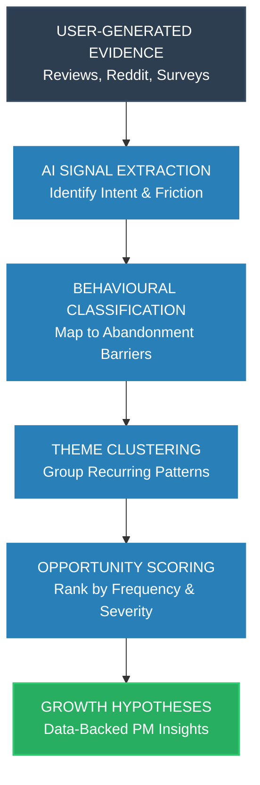

# AI Discovery Engine - Flow

To generate a PNG of this flow, you can view this markdown file in an editor that supports Mermaid (like VS Code or GitHub) and export it, or paste it into [Mermaid Live Editor](https://mermaid.live).

